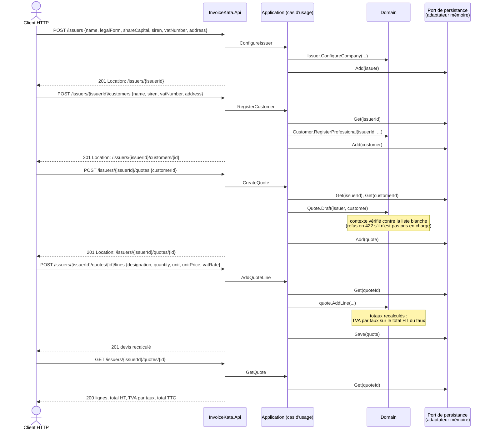
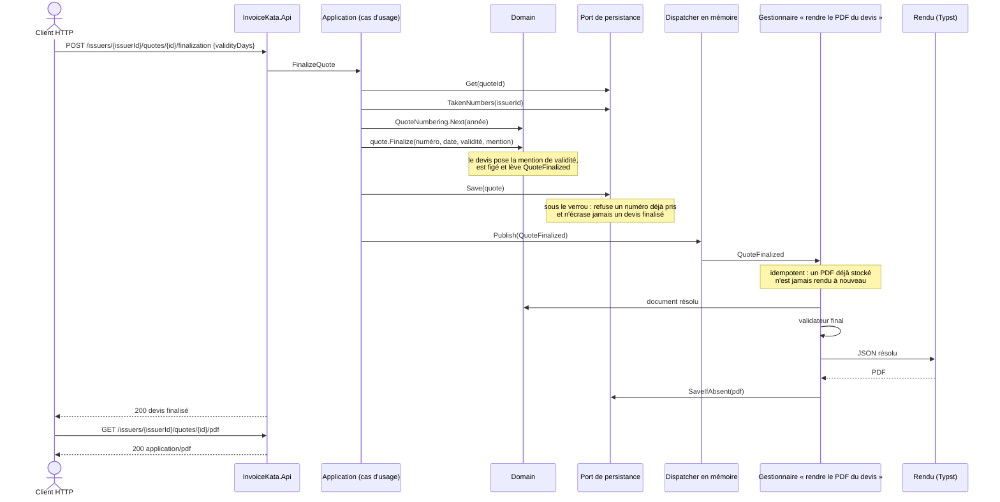

# L'API

Cette documentation vit avec le code : chaque nouvelle route y entre avec son diagramme de séquence.

## Conventions

- **Un SaaS multi-émetteur** ([ADR-0007](adr/ADR-0007-saas-multi-emetteur.md)). Chaque ressource
  appartient à un émetteur, désigné dans la route : `/issuers/{issuerId}/…`.
- **Ressources REST** : `issuers`, et sous chaque émetteur `customers`, `quotes` et les `lines` d'un
  devis, puis `invoices`.
- **Identifiants** : des GUID v4 aléatoires générés par le serveur, impossibles à deviner. Les numéros
  légaux (devis, facture) sont attribués à la finalisation et à l'émission, jamais à la création.
- **Erreurs** au format Problem Details (RFC 9457) :

  | Code | Cas |
  |---|---|
  | `400` | Donnée invalide |
  | `404` | Ressource inconnue, ou appartenant à un autre émetteur |
  | `409` | Action interdite par l'état du document, par exemple modifier un devis finalisé |
  | `422` | Contexte de facturation non pris en charge ([ADR-0002](adr/ADR-0002-variations-selon-emetteur-et-client.md)) |

- **Vocabulaire** : `quote` (une offre de prix ferme, qui engage une fois acceptée), et non `estimate`,
  qui désigne une estimation sans engagement.

## Les routes

### Émetteurs, clients et devis

| Méthode et route | Rôle | Réponse |
|---|---|---|
| `POST /issuers` | Configurer un émetteur de type société : dénomination, forme juridique (`SA`, `SAS`, `SASU`, `SARL`, `EURL`, `SNC`), capital, SIREN, n° de TVA, adresse | `201`, avec `Location: /issuers/{issuerId}` ; `400` si la forme juridique est inconnue |
| `GET /issuers/{issuerId}` | Lire un émetteur | `200` |
| `POST /issuers/{issuerId}/customers` | Enregistrer un client : `kind` (`Professional` par défaut, ou `Individual`), nom, adresse, et pour un professionnel le SIREN et le n° de TVA | `201`, avec `Location: /issuers/{issuerId}/customers/{id}` ; `400` si le type est inconnu, ou si un professionnel n'a pas de SIREN ou de n° de TVA |
| `GET /issuers/{issuerId}/customers/{id}` | Lire un client | `200` |
| `POST /issuers/{issuerId}/quotes` `{ customerId }` | Créer un devis brouillon pour ce client | `201`, avec `Location: /issuers/{issuerId}/quotes/{id}` ; `422` si le contexte de facturation n'est pas pris en charge (seul le contexte société × professionnel l'est) |
| `POST /issuers/{issuerId}/quotes/{id}/lines` | Ajouter une ligne : désignation, quantité, unité, prix unitaire HT, taux de TVA, et une remise en % facultative | `201`, avec `Location: …/lines/{lineId}` et le devis recalculé dans le corps |
| `DELETE /issuers/{issuerId}/quotes/{id}/lines/{lineId}` | Retirer une ligne | `200`, avec le devis recalculé ; `404` si la ligne n'est pas sur le devis |
| `GET /issuers/{issuerId}/quotes/{id}` | Lire le devis : statut, numéro et dates (vides pour un brouillon), lignes, totaux (HT, TVA, TTC), ventilation de la TVA par taux, mentions légales (`code` et `text`) | `200` |
| `GET /issuers/{issuerId}/quotes/{id}/pdf` | Télécharger le PDF du devis finalisé, nommé d'après son numéro (`D-2026-0001.pdf`) | `200` `application/pdf` ; `409` si le devis est encore un brouillon |
| `POST /issuers/{issuerId}/quotes/{id}/finalization` `{ validityDays }` | Finaliser le devis : il reçoit son numéro (`D-2026-0001`, une séquence par émetteur et par année), sa date (le jour de la finalisation, à l'heure de Paris), sa date de validité et la mention de validité, puis il est figé. `validityDays` est facultatif : 30 jours par défaut, de 1 à 365 | `200`, avec le devis finalisé ; `400` si la validité sort de 1 à 365 jours ; `409` si le devis est déjà finalisé, s'il n'a aucune ligne, ou si une finalisation simultanée a pris le même numéro (on relance alors la finalisation) |

Un devis finalisé refuse toute modification : ajouter ou retirer une ligne répond `409`. Ses montants sont
enregistrés tels qu'émis, et ne sont plus recalculés ([ADR-0009](adr/ADR-0009-documents-legaux-jamais-reecrits.md)).
La numérotation est décrite par le [CDR-0007](cdr/CDR-0007-numerotation-des-devis.md).

### Factures

| Méthode et route | Rôle | Réponse |
|---|---|---|
| `POST /issuers/{issuerId}/invoices` `{ quoteId, paymentDays }` | Émettre la facture d'un devis finalisé : elle reprend le devis tel qu'émis, reçoit son numéro (`F-2026-0001`, une suite continue par émetteur et par année), sa date (à l'heure de Paris), son échéance et les mentions de paiement. `paymentDays` est facultatif : 30 jours par défaut, de 1 à 60 (le plafond légal entre professionnels) | `201`, avec `Location: /issuers/{issuerId}/invoices/{id}` et la facture dans le corps ; `400` si le délai sort de 1 à 60 jours ; `404` si le devis est inconnu ; `409` si le devis est encore un brouillon, s'il a déjà sa facture, ou si une émission simultanée a pris le même numéro |
| `GET /issuers/{issuerId}/invoices/{id}` | Lire la facture : numéro, dates, devis d'origine, lignes, totaux, ventilation de la TVA, mentions | `200` |
| `GET /issuers/{issuerId}/invoices/{id}/pdf` | Télécharger le PDF de la facture, nommé d'après son numéro (`F-2026-0001.pdf`) | `200` `application/pdf` |

Une facture ne se modifie jamais : aucune route ne la change, et le port ne sait que l'ajouter. Son PDF est
rendu en réaction à `InvoiceIssued`, juste après l'enregistrement, avec le même template que le devis
([ADR-0010](adr/ADR-0010-facture-emise-depuis-un-devis-finalise.md)).

Les montants légaux (total de ligne, TVA par taux, totaux) sont arrondis au centime, à mi-chemin vers le haut (0,125 donne 0,13) ; les valeurs saisies, comme le prix unitaire et le prix net après remise (33,33 € − 10 % = 29,997 €), restent en pleine précision. La TVA est calculée une fois par taux, sur le total HT de ce taux, et non ligne par ligne ([ADR-0008](adr/ADR-0008-arrondis.md)).

### Où intervient la chorégraphie

Il y a deux moments de dispatch ([ADR-0003](adr/ADR-0003-reactions-par-evenements-idempotentes.md),
amendement) :

- **Dans l'unité de travail, avant l'enregistrement.** Les **mentions légales** réagissent à
  `QuoteDrafted`, `QuoteLineAdded` et `QuoteLineRemoved`. Chaque gestionnaire réévalue l'état courant du
  devis, ce qui le rend idempotent. Quand l'API répond, le devis est déjà complet. Le recalcul des totaux
  et de la TVA, lui, reste un calcul du domaine, sans événement.
- **Après l'enregistrement.** Les **réactions à un fait acquis** : `QuoteFinalized` déclenche le rendu du
  PDF du devis, et `InvoiceIssued` celui du PDF de la facture.

Le validateur final ne s'exécute qu'une fois terminées toutes les réactions déclenchées.

La finalisation d'un devis. Le domaine calcule le numéro à partir de ceux que l'émetteur a déjà pris, et
le port refuse un doublon sous son verrou ([CDR-0007](cdr/CDR-0007-numerotation-des-devis.md)). L'événement
`QuoteFinalized` n'est publié **qu'après l'enregistrement** du devis figé, pour qu'aucune réaction ne parte
d'un fait qui n'a pas été enregistré. Sa réaction, le rendu du PDF, s'exécute dans la même requête : si elle
échoue, le devis reste finalisé, l'échec est journalisé, et la lecture du PDF relance le rendu
([ADR-0005](adr/ADR-0005-rendu-pdf-par-typst.md), amendement) :

## Options écartées

| Option | Raison |
|---|---|
| Des routes en verbes (`/createQuote`, `/addLine`) | Du RPC déguisé : l'API perd la sémantique HTTP (méthodes, codes, cache). |
| `PUT /quotes/{id}` avec toutes les lignes | Remplacer le devis entier masque l'intention (ajout ou retrait) et complique les invariants. |
| `PATCH` en JSON Patch sur les lignes | Une complexité inutile pour deux opérations, l'ajout et le retrait. |
| `/customers/{id}/quotes` | Le devis a sa propre identité et son propre cycle de vie : il n'appartient pas à la ressource client. |
| `/quotes/{id}/invoice` pour la facture | Une facture a sa propre identité légale, son numéro et sa conservation. Elle est donc une ressource à part, qui référence son devis. |
| `estimates` ou `/devis` | `estimate` est un contresens juridique, et `/devis` contredit la règle de langue du code. |
| L'émetteur dans un en-tête, ou une instance par émetteur | Voir l'[ADR-0007](adr/ADR-0007-saas-multi-emetteur.md). |
