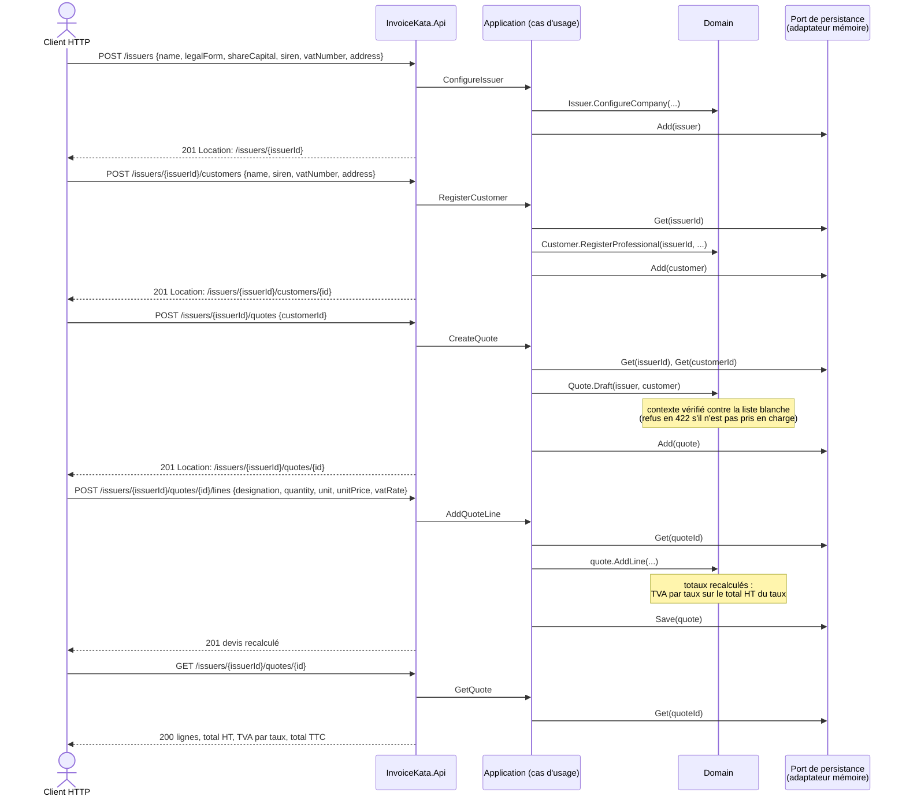
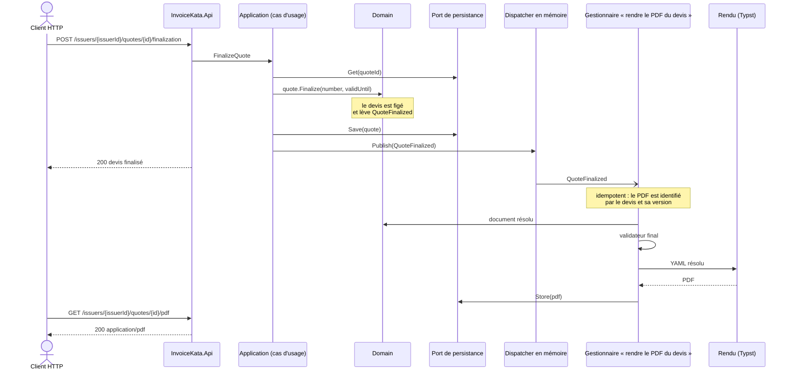

# L'API

Cette documentation vit avec le code : chaque nouvelle route y entre avec son diagramme de séquence.

## Conventions

- **Un SaaS multi-émetteur** ([ADR-0007](adr/ADR-0007-saas-multi-emetteur.md)). Chaque ressource
  appartient à un émetteur, désigné dans la route : `/issuers/{issuerId}/…`.
- **Ressources REST** : `issuers`, et sous chaque émetteur `customers`, `quotes` et les `lines` d'un
  devis, puis `invoices`.
- **Identifiants** : des GUID v4 aléatoires générés par le serveur, impossibles à deviner. Les numéros
  légaux (devis, facture) sont attribués à la finalisation et à l'émission, jamais à la création.
- **Erreurs** au format Problem Details (RFC 9457) :

  | Code | Cas |
  |---|---|
  | `400` | Donnée invalide |
  | `404` | Ressource inconnue, ou appartenant à un autre émetteur |
  | `409` | Action interdite par l'état du document, par exemple modifier un devis finalisé |
  | `422` | Contexte de facturation non pris en charge ([ADR-0002](adr/ADR-0002-variations-selon-emetteur-et-client.md)) |

- **Vocabulaire** : `quote` (une offre de prix ferme, qui engage une fois acceptée), et non `estimate`,
  qui désigne une estimation sans engagement.

## Les routes

### Émetteurs, clients et devis brouillon

| Méthode et route | Rôle | Réponse |
|---|---|---|
| `POST /issuers` | Configurer un émetteur de type société : dénomination, forme juridique (`SA`, `SAS`, `SASU`, `SARL`, `EURL`, `SNC`), capital, SIREN, n° de TVA, adresse | `201`, avec `Location: /issuers/{issuerId}` ; `400` si la forme juridique est inconnue |
| `GET /issuers/{issuerId}` | Lire un émetteur | `200` |
| `POST /issuers/{issuerId}/customers` | Enregistrer un client professionnel : nom, SIREN, n° de TVA, adresse | `201`, avec `Location: /issuers/{issuerId}/customers/{id}` |
| `GET /issuers/{issuerId}/customers/{id}` | Lire un client | `200` |
| `POST /issuers/{issuerId}/quotes` `{ customerId }` | Créer un devis brouillon pour ce client | `201`, avec `Location: /issuers/{issuerId}/quotes/{id}` |
| `POST /issuers/{issuerId}/quotes/{id}/lines` | Ajouter une ligne : désignation, quantité, unité, prix unitaire HT, taux de TVA | `201`, avec `Location: …/lines/{lineId}` et le devis recalculé dans le corps |
| `GET /issuers/{issuerId}/quotes/{id}` | Lire le devis : lignes, totaux (HT, TVA, TTC), ventilation de la TVA par taux | `200` |

Les montants sont arrondis au centime, à mi-chemin vers le haut (0,125 donne 0,13). La TVA est calculée une fois par taux, sur le total HT de ce taux, et non ligne par ligne.

### Où intervient la chorégraphie

Il y a deux moments de dispatch ([ADR-0003](adr/ADR-0003-reactions-par-evenements-idempotentes.md),
amendement) :

- **Dans l'unité de travail, avant l'enregistrement.** Les **mentions légales** réagissent à
  `QuoteDrafted`, `QuoteLineAdded` et `QuoteLineRemoved`. Chaque gestionnaire réévalue l'état courant du
  devis, ce qui le rend idempotent. Quand l'API répond, le devis est déjà complet. Le recalcul des totaux
  et de la TVA, lui, reste un calcul du domaine, sans événement.
- **Après l'enregistrement.** Les **réactions à un fait acquis** : `QuoteFinalized` déclenche le rendu du
  PDF du devis, et `InvoiceIssued` celui du PDF de la facture.

Le validateur final ne s'exécute qu'une fois terminées toutes les réactions déclenchées.

Exemple avec la finalisation d'un devis (route à venir). L'événement n'est publié **qu'après
l'enregistrement** du devis figé, pour qu'aucune réaction ne parte d'un fait qui n'a pas été enregistré :

### Routes à venir, pour situer l'ensemble

Toutes sous `/issuers/{issuerId}` :

| Fonctionnalité | Routes |
|---|---|
| Retrait d'une ligne | `DELETE /quotes/{id}/lines/{lineId}` |
| Finalisation du devis | `POST /quotes/{id}/finalization` |
| PDF du devis | `GET /quotes/{id}/pdf` |
| Facture | `POST /invoices` `{ quoteId }`, `GET /invoices/{id}`, `GET /invoices/{id}/pdf` |

## Options écartées

| Option | Raison |
|---|---|
| Des routes en verbes (`/createQuote`, `/addLine`) | Du RPC déguisé : l'API perd la sémantique HTTP (méthodes, codes, cache). |
| `PUT /quotes/{id}` avec toutes les lignes | Remplacer le devis entier masque l'intention (ajout ou retrait) et complique les invariants. |
| `PATCH` en JSON Patch sur les lignes | Une complexité inutile pour deux opérations, l'ajout et le retrait. |
| `/customers/{id}/quotes` | Le devis a sa propre identité et son propre cycle de vie : il n'appartient pas à la ressource client. |
| `/quotes/{id}/invoice` pour la facture | Une facture a sa propre identité légale, son numéro et sa conservation. Elle est donc une ressource à part, qui référence son devis. |
| `estimates` ou `/devis` | `estimate` est un contresens juridique, et `/devis` contredit la règle de langue du code. |
| L'émetteur dans un en-tête, ou une instance par émetteur | Voir l'[ADR-0007](adr/ADR-0007-saas-multi-emetteur.md). |
